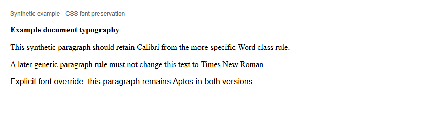
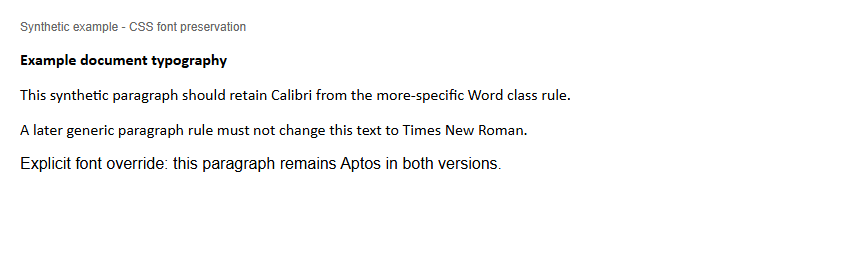

# CSS inlining and Word font preservation

`convertInlineCss()` is shared by HTML paste and `createModelFromHtml()`.
It combines stylesheet declarations with original inline declarations before
DOM-to-model conversion. Inspect final `element.style` to identify a cascade
problem before changing a format parser.

## Why Calibri became Times New Roman

A Word export can contain an earlier `p.MsoNormal` rule selecting Calibri and a
later generic `p` rule selecting Times New Roman. The old inliner kept source
order but discarded selector specificity, so the generic fallback won.
The font-family parser correctly imported the already-incorrect inline font.

The inliner now ranks individual selectors lexicographically by ID,
class/attribute/pseudo-class, and type counts, then source order for ties.
Grouped rules use the specificity of each matching selector, not an unmatched
ID selector. `:is()`, `:not()`, and `:has()` use the most specific argument;
`:where()` contributes zero specificity. Selector-list splitting respects
nested functions, attributes, and escaped commas.

Matching is collected before adding style attributes so selectors cannot start
matching merely because another rule was inlined. Original inline declarations
remain last, including proprietary inline `mso-*` text. The browser resolves
`!important` and shorthand/longhand declarations. No font is forced and no new
runtime dependency is added.

This is not a complete browser cascade implementation: conditional at-rules,
cascade layers, and CSS nesting remain outside this correction.

## Regression coverage

Core tests exercise selector specificity, equal-specificity source order,
grouped and functional selectors, escaped identifiers, inline precedence,
`!important`, and matching before style mutation. The Word end-to-end case
retains Calibri, an explicit 12-point run, and an explicit Aptos override.

```powershell
yarn test:fast --testPathPattern="createModelFromHtml|cmPasteFromWordTest|paste|copyPaste|createPasteFragment"
yarn eslint
yarn b
```

## Public screenshot evidence

The before/after images use the same synthetic Word-style fixture and viewport.
They contain no original document text. The explicit Aptos override remains
unchanged while body text changes from the incorrect fallback to Calibri.




