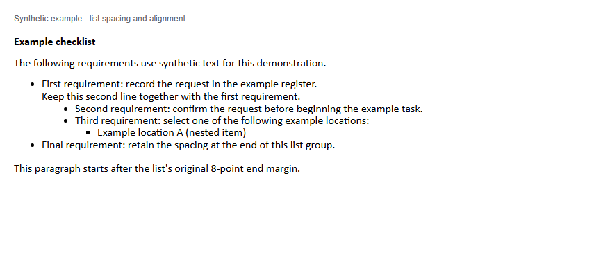
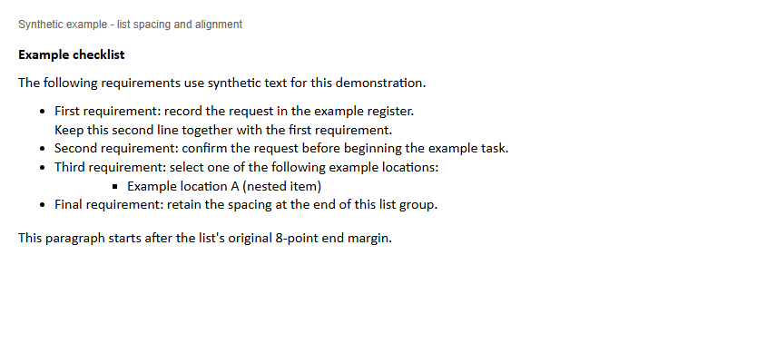

# Paste pipeline and debugging playbook

This guide describes Content Model paste, including the built-in `CopyPastePlugin`
and the optional source-aware `PastePlugin`. Use it as the context and acceptance
contract for a future paste-fix skill or software factory.

Paths below are relative to the repository root.

## The two plugins have different jobs

`packages\roosterjs-content-model-core\lib\corePlugin\copyPaste\CopyPastePlugin.ts`
owns native clipboard events. It prevents native paste when supported, asynchronously
extracts the clipboard items, checks that the editor has not been disposed, and calls
the core `paste()` command with the configured default paste type. Android has a
special native-paste fallback for unsupported Office file clipboard items.

`packages\roosterjs-content-model-plugins\lib\paste\PastePlugin.ts` is an editor plugin
that listens to `beforePaste`. It does not read the operating system clipboard,
merge the document, or render the result. It identifies source applications,
normalizes source-specific HTML, and installs conversion parsers, processors, and
sanitizers on that paste event.

Calling `paste(editor, clipboardData)` directly exercises the same conversion and
merge path as native paste, without reproducing asynchronous clipboard extraction.
Install `new PastePlugin()` in the editor options for source-aware regression tests;
the core command alone does not install it.

## Pipeline and observation points

| Stage                 | Code                                                                                                            | Responsibility and useful evidence                                                                                                                                                                                                                                    |
| --------------------- | --------------------------------------------------------------------------------------------------------------- | --------------------------------------------------------------------------------------------------------------------------------------------------------------------------------------------------------------------------------------------------------------------- |
| Clipboard extraction  | `packages\roosterjs-content-model-dom\lib\domUtils\event\extractClipboardItems.ts`                              | Read HTML, text, images, allowed custom text types, and files into `ClipboardData`. Retain `types`, `rawHtml`, text, and native-event information when relevant.                                                                                                      |
| Paste orchestration   | `packages\roosterjs-content-model-core\lib\command\paste\paste.ts`                                              | Focus the editor and save a cloned pre-paste model on the first paste. Prepare HTML with the configured `DOMCreator`; comment cleanup depends on its bypass setting. Resolve the paste type.                                                                          |
| HTML information      | `packages\roosterjs-content-model-core\lib\command\paste\retrieveHtmlInfo.ts`                                   | Extract document metadata, top-level tags, block presence, and CSS rules. Locate `StartFragment`/`EndFragment`; update `clipboardData.html` to the selected fragment while keeping the surrounding HTML separately. Without markers, use all of `rawHtml`.            |
| Fragment creation     | `packages\roosterjs-content-model-dom\lib\domUtils\event\createPasteFragment.ts`                                | Choose HTML, plain text, or image content according to paste type and available data. The raw document's stylesheet is not itself the selected body fragment.                                                                                                         |
| Plugin customization  | `packages\roosterjs-content-model-core\lib\command\paste\generatePasteOptionFromPlugins.ts`                     | Broadcast `beforePaste` with the fragment, clipboard data, metadata, surrounding HTML, mutable CSS rules, and fresh sanitizing conversion options. Inspect both fragment mutations and installed callbacks.                                                           |
| Source handling       | `packages\roosterjs-content-model-plugins\lib\paste\PastePlugin.ts`                                             | Detect the source, apply its processor, then add common link, border, image, button, and sanitizer behavior. Merge-format paste also adds block/list-level formatting parsers.                                                                                        |
| CSS inlining          | `packages\roosterjs-content-model-core\lib\command\createModelFromHtml\convertInlineCss.ts`                     | Extract browser-recognized style rules and remove style nodes; later apply the rules to matching fragment elements. Existing inline declarations take precedence over prepended global declarations. Inspect final `element.style`, not just the original stylesheet. |
| Sanitizing conversion | `packages\roosterjs-content-model-core\lib\command\createModelFromHtml\createDomToModelContextForSanitizing.ts` | Combine editor settings, paste defaults, and plugin overrides into a DOM-to-model context. Paste defaults handle text, display, whitespace, general elements, and entities.                                                                                           |
| Model merge           | `packages\roosterjs-content-model-core\lib\command\paste\mergePasteContent.ts`                                  | Convert the fragment to a Content Model, merge at the selection or use `customizedMerge`, set pending formatting, and record the `Paste` change. A later paste-option selection restores the saved pre-paste model before merging again.                              |
| Rendering             | `packages\roosterjs-content-model-dom\lib\modelToDom\handlers\handleListItem.ts`                                | Render list wrappers and list items, apply the marker's segment format and the item's block format, then render child blocks. Compare model formats with final CSS and measured layout.                                                                               |

CSS inlining combines matching stylesheet declarations with original inline
declarations before conversion. Inspect final `element.style` when debugging
font or style mismatches, which may be separate from list spacing. Do not
compensate for a font mismatch by inventing margins or changing all pasted fonts.

## Source detection and customization

`packages\roosterjs-content-model-plugins\lib\paste\pasteSourceValidations\getDocumentSource.ts`
uses ordered detectors: Word Desktop, Excel Desktop, Excel Online, PowerPoint,
WAC components, Google Sheets, single image, non-native Excel, and OneNote.
The first match wins; unmatched content uses the default path. Some source kinds
are recognized without a dedicated branch in `PastePlugin`.

Word detection recognizes its document namespace or `ProgId: Word.Document`.
Safari also has a raw-HTML namespace check because it can strip metadata.
Preserve these indicators in a reduced fixture, or a Word test may silently
exercise ordinary HTML paste instead.

`addParser()` appends to a format category; it does not replace the default
parsers. `setProcessor()` installs an element processor override. Format-parser
overrides instead replace a format key. See
`packages\roosterjs-content-model-dom\lib\domToModel\context\createDomToModelContext.ts`
for their composition and ordering.

Sanitization is not simply "remove every unknown element": the paste general
processor recreates allowed general elements with sanitizers, discards disallowed
general elements, and processes other unknown elements like spans. Specific tag
processors and entities have their own paths. Keep changes in the correct path,
and never bypass sanitization to recover formatting.

## How Word Desktop lists become real lists

The entry point is
`packages\roosterjs-content-model-plugins\lib\paste\WordDesktop\processPastedContentFromWordDesktop.ts`.

1. Normalize global Word list-paragraph CSS with `removeListParagraphMargins()`.
   It removes horizontal margins that conflict with synthesized list indentation,
   but preserves vertical margins, including shorthand top/bottom values. Mixed
   selectors are split so non-list paragraphs keep their original declarations.
   This happens before CSS inlining and mutates the same event CSS-rule array.
   The original `MsoListParagraph` styles are retained by tag so equivalent inline
   default margins can be normalized too, without guessing a fixed Word indent.
2. Extract Word's `@list lN:levelN` metadata from raw surrounding HTML using
   `getStyleMetadata()`. Browser CSS rules do not expose this proprietary metadata.
3. Install an element processor that tries `processWordList()`, then Word comment
   handling, before falling back to the default element processor.
4. Recognize `mso-list:lN levelN lfoN` on paragraph/list elements, and ignore
   `mso-list:Ignore` fake marker spans. Use metadata to determine ordered versus
   unordered lists, marker templates, and starting numbers.
5. `setupListFormat()` in `lib\paste\utils\customListUtils.ts` builds the levels.
   `processAsListItem()` parses the item's own text format and marker format,
   creates a `ContentModelListItem`, processes its children, and adds it to the
   parent group. List levels describe wrappers; item format describes the item;
   the format holder describes the bullet/number.
6. Maintain known levels per Word list identity. Nested levels and numbered
   headings have specialized indentation/label handling; preserve these when
   fixing spacing. A Word export can skip levels, such as level 1 to level 3.

An imported Word list paragraph is not necessarily an ordinary model paragraph.
Its content can become an implicit paragraph inside a list item. A parser attached
only to `block` therefore does not cover the list item's own formatting.

## Case study: compressed Word list spacing

The reported capture uses `line-height:107%` on list paragraphs and text runs,
including nested items. It also contains `MsoListParagraphCxSpFirst`, `Middle`,
and `Last` classes with explicit zero margins within groups and 8-point bottom
margins at selected group ends.

Rooster already uses `adjustPercentileLineHeight()` for Word paragraph blocks.
It translates Word percentage spacing using the existing browser line-height
multiplier: `107%` becomes unitless `1.284` (`1.2 * 1.07`), and `normal` becomes
`120%`. This is a Word compatibility heuristic, not a universal CSS conversion
or a guarantee of pixel-identical Word layout.

Previously, list-item formats and inline text formats bypassed that adjustment.
Their unadjusted `107%` declarations controlled the rendered line boxes, even
when a surrounding paragraph had adjusted spacing. At a 12-point font, the
computed line height was 17.12 pixels rather than 20.544 pixels.

The fix reuses the same parser for `listItemElement`, `segment`, and
`styleBasedSegment` as well as `block`. Explicit point/pixel and unitless line
heights remain unchanged. The parser derives its result from the element's style,
not by multiplying an already-adjusted model value. Zero margins and 8-point
group-end margins remain intact; no arbitrary gaps or blank paragraphs are added.

Regression coverage is in
`packages\roosterjs-content-model-plugins\test\paste\e2e\cmPasteFromWordTest.ts`:
normal paragraphs plus inline runs, a wrapped item, level-3 nesting, group-end
margins, and explicit/non-percentage list spacing. Older Word conversion snapshots
also assert the adjusted line heights while retaining their numbering, colors,
fonts, margins, and structure.

The local file named `assets\test\clipboardData.json` was empty during this
investigation; the populated sibling `clipboardData (1).json` matched the report.
The full capture was replayed locally, without importing its saved pre-paste
model. The committed regression uses reduced synthetic text, not the full capture
or its local file paths.

### Follow-up: classless siblings were still horizontally misaligned

The first top-level item uses `MsoListParagraph`, while the next two paragraphs
have no list class and express the same default indentation as inline
`margin-left:.5in`. All three carry the same `mso-list` identity and level.
Removing only the first item's stylesheet margin left an extra 48-pixel offset
on its classless siblings. The vertical-spacing fix did not correct this.

`removeListParagraphMargins()` now returns the original list paragraph style
declarations by tag before stripping their horizontal margins. When processing a
top-level Word list paragraph, `processWordList()` compares its inline left margin
with the exported default in equivalent units. A match is normalized on the item
and list wrapper; custom margins, ordinary non-list paragraphs, and numbered
headings keep their existing behavior. Nested levels remain indented.

The mixed-class regression measures both item and text x-positions. It runs with
either a classed or classless item first, and includes a `36pt` equivalent of
`.5in` and a level-3 nested item. Separate coverage retains a custom `1in` margin
and an ordinary paragraph's margin. The full local capture is also checked for
equal text x-positions on its first three list items, not just larger line heights.

### Public screenshot evidence

The before/after images use synthetic text, not the original document.
Both images use the same fixture, viewport, font size, and scale.





## Repeatable validation loop

1. **Define the visual invariant.** Specify what should survive paste: line-box
   spacing, list-end margin, indentation, marker type, or wrapping. Record browser,
   viewport, source font availability, zoom, paste type, and insertion context.
   Screenshots with different zooms and widths are not pixel-comparable.
2. **Check evidence first.** Confirm the capture exists, is nonempty, and parses.
   Keep full HTML locally; do not execute pasted scripts, follow file URLs, or
   publish document text and personal data. Keep source-detection metadata.
3. **Replay with fresh state.** Use an editor with `PastePlugin` and a new
   `ClipboardData` object per case. Copy input fields, not `modelBeforePaste`.
   `paste()` mutates clipboard state; a saved model is for re-paste, not the source
   document. Dispose the editor and remove test DOM when done.
4. **Find the first divergent stage.** Inspect raw CSS and inline styles, detected
   source, the `beforePaste` options, styles after CSS inlining, converted model,
   merged model, and rendered DOM. Separate lost data from data that is present
   but applied to the wrong node/category.
5. **Reduce and prove failure.** Preserve relevant classes, `@list` metadata,
   `mso-list` declarations, marker spans, mixed font sizes, and nesting. Replace
   document text with synthetic labels. Add a focused regression that fails
   before changing production code.
6. **Fix the earliest responsible layer.** Prefer an existing source-aware parser
   or processor. Avoid changing all HTML paste for a Word-only incompatibility.
   Check relevant call sites and snapshot expectations; do not mechanically
   accept unrelated snapshot changes.
7. **Prove the actual result.** Assert model semantics and computed CSS. For a
   layout regression, measure line positions or bounding rectangles too: font
   metrics can make a line taller than the declared minimum. Replay the complete
   capture locally and compare before/after at the same viewport and scale.
8. **Close out.** Run the affected suites, lint, and build; remove diagnostic tests
   and local fixture imports. Leave reduced regressions and documentation, and
   report remaining differences or unavailable visual evidence plainly.

### Commands

Run from the repository root:

```powershell
# Focused Word regression and existing line-height parser cases
yarn test:fast --testPathPattern="cmPasteFromWordTest|adjustPercentileLineHeightParserTest"

# Source-aware and core paste pipeline coverage
yarn test:fast --testPathPattern="paste|copyPaste|createPasteFragment|convertInlineCss"

yarn eslint
yarn b
```

Use `yarn test:fast` for local tests. `--testPathPattern` selects file paths with a
regular expression; this build's Jasmine name filter is a substring filter, so
do not use `|` to combine names in `--testNamePattern`. Use Safari coverage only
when needed and on a supported macOS/Safari environment.

## Contract for a future skill or software factory

**Inputs:** clipboard capture path, source application/version if known, expected
and actual screenshots, paste type, insertion context, browser/viewport/zoom,
and a measurable acceptance condition.

**Checkpoints:** evidence accepted; native/direct replay reproduced; first
divergent stage identified; reduced regression fails; scoped correction applied;
model/layout and adjacent-source checks pass; full-capture replay reviewed;
temporary artifacts removed.

**Outputs:** root cause with code locations, a minimal patch, synthetic regression
fixture, test/lint/build results, local before/after evidence, and explicit
limitations. Do not publish the original clipboard capture by default.

**Completion gate:** the regression fails without the fix and passes with it;
source metadata actually selects the intended processor; layout is checked rather
than inferred solely from model JSON; adjacent behavior remains covered; required
checks pass; no diagnostic code or user-data fixture dependency remains.

**Stop conditions:** missing/unreadable capture, insufficient evidence to identify
the expected spacing, unavailable required platform, restricted files, or a
failure that cannot safely be resolved within scope. Report the blocker rather
than substituting arbitrary spacing or claiming pixel-perfect fidelity.
